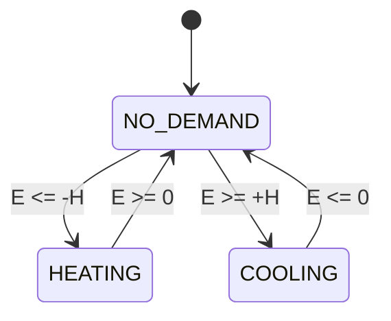

# Control Loop — Algorithm & Module Design

Design contract derived from `control-loop-concept-brief.md`. Notation is language-neutral
pseudocode. Assumptions marked **[A-n]** are resolved in §5. Implemented in `heatnrgx/core/`.

---

## 1. Algorithm

### 1.1 Model

The house is a lumped thermal capacity. The controller integrates the **net power balance** into a
single scalar **energy deviation** `E` — the charge error of the thermal battery, in Wh — and applies
a relay (hysteresis) to `E`.

```
p_transmission = k_trans * (T_outdoor - T_indoor)          # W, >0 = house gains from outside
p_model        = p_produced + p_solar + p_internal + p_transmission
p_trim         = a_trim * clamp(T_indoor - T_set, ±L)      # W, <0 when too cold => more heat
p_net          = p_model + p_trim                          # W, <0 = deficit, >0 = surplus

E             += ∫ p_net dt / 3600                         # Wh
```

The trim's **deviation** is clamped at `±L` (`trim_limit_k`, 3 K), not the resulting power —
so the limit stays readable in kelvin and does not move when `a_trim` is retuned **[A-14]**.

`p_model` is the **prediction** (feed-forward): given everything flowing in and out right now, is the
house gaining or losing? `p_trim` is the **correction**: the deviation between measured and desired
indoor temperature converted into an equivalent power and folded into the same balance, so error is
continuously repaid instead of accumulating. The two are never arbitrated or blended — they are
summed in W and integrated once. `p_model` supplies the lead that raw room-temperature hysteresis
lacks.

This is **feedforward plus a proportional trim**, not a PI controller. The integration converts watts
into the watt-hours the relay needs so that hysteresis has physical meaning (§1.3); it does *not*
provide integral action on temperature, because the relay bounds `E` and a bounded integrator cannot
accumulate a persistent output. Steady-state effort comes from `p_model`, which is *computed* rather
than learned — so a biased `p_model` leaves a standing temperature offset. §1.9 quantifies it exactly.
Read that before choosing `adjustment_w_per_k`.

`p_produced` is inside the balance **[A-2]**: while the heat pump runs, `p_net` turns positive, `E`
climbs back toward 0, and the relay releases. Without it the loop could never release.

### 1.2 Time and asynchronous inputs — the integral

Every input is a power or a temperature **sampled at an instant**; `E` is an **energy**. The only
thing that converts one into the other is elapsed time, so time handling *is* the algorithm, not
plumbing around it. Inputs arrive independently, at unrelated cadences, from unrelated sources.

**Signal reconstruction — zero-order hold (ZOH) [A-17].** Each of the five inputs is held at its
last observed value until the next observation for *that* signal. All five signals therefore have a
defined value at every instant, and `p_net(t)` is a **piecewise-constant** function whose breakpoints
are exactly the observation instants. Over an interval containing no observation, `p_net` is constant,
so the integral over it is exact — not an approximation:

```
E += p_net(over the interval) * (t1 - t0) / 3600
```

**The single moving part: `advance_to(t)`.** Exactly one function advances the time reference and
mutates `E`. Every other entry point calls it first and does nothing time-related itself.

```
advance_to(state, t):
    if state.t_last is None:  t_last := t ; return                # seed only, no integral
    dt := t - state.t_last
    if dt <= 0:               return                              # no time travel  [A-18]
    inputs := resolve(signals, at = state.t_last)                 # validity at interval START
    if inputs is not None and dt <= max_step_s:                   # trustworthy interval  [A-19]
        E := clamp(E + p_net(inputs) * dt / 3600)
    t_last := t                                                   # advance either way
```

**Integrate-then-update.** A new observation describes the state of the world *from its timestamp
onward*, never before it. So ingesting a reading is:

```
observe(state, signal, value, t):
    drop if value is not finite
    drop if t < timestamp already held for THIS signal        # stale duplicate  [A-18]
    advance_to(state, t)                                      # close the interval with the OLD value
    signals[signal] := (value, t)                             # only now does the new value take effect
```

Reversing these two lines attributes the new value to an interval it did not govern — the classic
async-integration bug, and the reason this ordering is stated as a contract rather than left to the
implementer.

**Interval validity is evaluated at the interval start**, because that is what ZOH says was true
throughout it. Output health (§1.6) is evaluated at the interval *end*, because that is what is true
now. These are deliberately different instants.

**Heartbeat, at two rates.** `evaluate(t)` must be called on a fixed tick even when no input has
changed, or a quiet system never advances time and never engages. Required:
`tick_interval_s << max_step_s` (default 60 s vs 300 s). Between decisions the runtime also calls
`advance(t)` every `integration_interval_s` (10 s), which integrates without deciding — the split
the legacy system uses **[A-24]**. Neither rate changes the integral, which is exact over
piecewise-constant signals; the fast one only resolves a step in pump power sooner.

**Ordering across signals is free.** Because every ingest closes the open interval at its own
timestamp, readings from five sources interleaved in any non-decreasing timestamp order produce the
same integral as if they had been perfectly synchronised. Readings that arrive *out of* timestamp
order are handled by the two drop rules above rather than by rewinding the integral **[A-18]**.

**Untrustworthy intervals are skipped, not clamped [A-19].** If the gap exceeds `max_step_s`, or a
required signal was stale at the interval start, the interval contributes **zero** energy and the
time reference jumps forward. Rationale: `E` is only meaningful over intervals that were actually
observed. Skipping under-states the deficit; the trim term then repays it from the real measured
temperature. Clamping instead would fabricate energy that nobody observed. One rule covers both the
stalled-process case and the dead-sensor case.

**Coverage is accounted, in seconds [A-22].** The controller keeps two lifetime totals,
`integrated_s` and `skipped_s`, whose sum is elapsed time. Every `Decision` carries both. This is the
health signal for the whole time model: `skipped_s` rising during normal operation means the
heartbeat is too slow or a source is dying. It must be seconds, not a per-call boolean — readings
close intervals *between* ticks, so an `evaluate` can legitimately find `dt = 0` with nothing left to
integrate, and a boolean would report that healthy case as a skip.

**Timeline example** (shipped defaults: `k_trans 155`, `a_trim 805`, `T_set 22`):

```
t=0    T_in=21.5  T_out=0  p_hp=0  p_sol=200  p_int=550   -> seed, E=0
t=60   evaluate                    p_net=-2985 W over [0,60)     E = -49.75 Wh
t=60   observe p_sol=1000          (integral for [0,60) already closed at old 200 W)
t=120  evaluate                    p_net=-2185 W over [60,120)   E = -86.17 Wh
```

If `p_sol` had been applied before closing `[0,60)`, `E` would read `-72.83` Wh — 15 % of the
accumulated deficit lost to one out-of-order line.

### 1.3 Relay (tri-state hysteresis)

`H = cfg.hysteresis_wh`. Engage at `∓H`, release at `0`. Deadband width `2H`; a direction change
costs `2H` of energy travel, so opposite demands can never abut.



```
relay(E: Wh, prev: Demand, H: Wh) -> Demand:
    prev = NO_DEMAND -> HEATING    if E <= -H
                        COOLING    if E >= +H
                        NO_DEMAND  otherwise
    prev = HEATING   -> NO_DEMAND  if E >= 0   else HEATING
    prev = COOLING   -> NO_DEMAND  if E <= 0   else COOLING
```

- **No `HEATING -> COOLING` edge exists.** Both directions route through `NO_DEMAND`.
- **At most one transition per evaluate.** The relay reads `prev` once.
- Release at exactly `0` means "the accumulated deficit has been repaid", not "the temperature is
  back" — that is the point of the design **[A-5]**.
- **Cycle sizing:** `t_on ≈ H / (P_delivered − P_loss)`, `t_off ≈ H / P_loss`. Choose
  `H = P_typical_deficit × t_min_half_cycle`.

### 1.4 Anti-windup clamp

Applied on every integration step and whenever the mask changes; bounds tightened by the mask
**[A-7,A-8]**:

```
e_hi = +H if COOLING not in allowed else +cfg.energy_clamp_factor * H
e_lo = -H if HEATING not in allowed else -cfg.energy_clamp_factor * H
E    = clamp(E, e_lo, e_hi)
```

Required whenever the plant cannot follow the demand (undersized, defrost, DHW priority, external
lockout, masked direction). Without it `E` diverges and the loop overshoots badly on recovery.

### 1.5 Signal resolution

```
resolve(signals, at) -> Inputs | None
    for each REQUIRED signal (T_indoor, T_outdoor, p_produced):
        absent, or (at - held.t) > max_age[signal]   ->  return None
    for each OPTIONAL signal (p_solar, p_internal):
        absent or stale  ->  substitute cfg.fallback(signal), record in
                             Inputs.substituted          [A-20, A-25]
    return Inputs(five floats)
```

Required signals gate the loop; optional gains degrade to their configured fallback (`0 W` for
`p_solar`, `550 W` for `p_internal` — see [A-25] and §4) and let the trim term repay the bias.
`p_produced` is required precisely because assuming `0 W` while the pump is actually running would
drive `E` down during heating and overheat the house.

### 1.6 Evaluate — output, health, lifecycle

```
evaluate(state, t) -> (state', Decision)

1  advance_to(state, t)                                   # §1.2 — the only integration
2  inputs := resolve(signals, at = t)                     # health NOW, not at interval start

3  phase = UNINITIALIZED:
       inputs is None -> emit NO_DEMAND, reason WAITING_FOR_INPUTS      (state.demand preserved)
       inputs present -> phase := RUNNING ; t_healthy := t
                         emit state.demand, reason SEEDED               (cold: NO_DEMAND;
                                                                         warm: restored demand)
4  phase = FAULT and inputs present:
       E := 0 ; demand := NO_DEMAND ; phase := RUNNING ; t_healthy := t
       emit NO_DEMAND, reason FAULT_RECOVERED                                        [A-11]

5  inputs is None:
       t - t_healthy <= input_hold_s -> phase := HOLD ; emit state.demand unchanged,
                                        reason HELD_STALE_INPUT
       otherwise                     -> phase := FAULT ; demand := NO_DEMAND,
                                        reason FAULT_TIMEOUT

6  normal:
       d := relay(E, state.demand, H)
       if d not in allowed: d := NO_DEMAND, reason MASKED else reason NORMAL
       demand := d ; phase := RUNNING ; t_healthy := t
       emit d
```

`evaluate` is the **only** function that changes `demand`; the masked result is what gets stored, so
the relay's `prev` always equals the demand that was actually emitted.

### 1.7 Startup

| Situation | `E` | `demand` | Behaviour | Output |
|---|---|---|---|---|
| Constructed, no input yet | `0` | `NO_DEMAND` | `t_last` seeds on first call | `NO_DEMAND` / `WAITING_FOR_INPUTS` |
| Some but not all required signals seen | `0` | `NO_DEMAND` | still `UNINITIALIZED` | `NO_DEMAND` / `WAITING_FOR_INPUTS` |
| All required signals present (cold start) | `0` | `NO_DEMAND` | seed only; **no integration** | `NO_DEMAND` / `SEEDED` |
| All required signals present (warm start, snapshot fresh) | restored | restored | seed only | restored demand / `SEEDED` |

Integration begins with the **second** evaluate after inputs resolve — the first only establishes the
time reference. `E` is never seeded from the temperature error **[A-9]**. The controller is always
queryable and always returns a well-defined demand, including before any input exists.

### 1.8 Worked trace (sign-convention anchor)

Shipped defaults: `T_set 22.0`, `k_trans 155`, `a_trim 805`, `H 1500`, `L 3 K`.

```
Winter, idle:  T_in 21.5  T_out 0.0  p_hp 0  p_sol 200  p_int 550
   p_transmission = 155*(0.0-21.5)  = -3332.5 W
   p_model        = 0+200+550-3332.5= -2582.5 W
   p_trim         = 805*(21.5-22.0) =  -402.5 W    (|dev| 0.5 K, inside the 3 K limit)
   p_net                            = -2985.0 W    -> -49.75 Wh/min
   E reaches -1500 Wh at t = 1809 s                -> HEATING engages (60 s tick: 1860 s)

Winter, heating: p_hp 6000 (thermal, space heating only)
   p_model = 6000+200+550-3332.5 = +3417.5 W ;  p_net = +3015 W
   E climbs -1500 -> 0 in ~29.9 min                -> releases to NO_DEMAND

Summer, idle:  T_set 24.0  T_in 26.0  T_out 32.0  p_sol 1500  p_int 550
   p_net = 155*(32-26) + 1500 + 550 + 805*(26-24)  = +4590 W
   E reaches +1500 Wh at t = 1176 s                -> COOLING engages
```

So a nominal winter cycle is ~30 min on, ~30 min off: **~1 cycle/h**. Simulated on the
two-node plant it comes out at 0.8/h, against the legacy system's ~0.5/h.

### 1.9 What the trim corrects, and what it only bounds

At equilibrium the relay holds `E` inside a bounded band, so the *average* of `p_net` over a cycle is
zero. Setting the controller's averaged balance against the true physics at the same equilibrium and
subtracting gives the **steady-state offset law**:

```
                    ΔG + (k_trans - k_true)·(T_out - T_set)
T_in - T_set  =  -  ---------------------------------------
                       a_trim - k_trans + k_true
```

which reduces, whenever `k_trans = k_true`, to the form worth memorising:

```
T_in - T_set  =  -p_model_error / a_trim
```

`ΔG` is the error in modelled gains and `p_model_error` is the surplus power the balance wrongly
believes exists — from a wrong `k_trans`, unmetered gains, a miscalibrated meter, any bias from any
source. Note `k_trans` appears in the denominator only because we reference transmission to
*measured* indoor temperature, which partially cancels the trim; the legacy references it to the
*target*, so its denominator is simply `P_adapt + k_true`. That is the whole reason its tuned
`650 W/K` maps to our `805` **[A-23]**. Consequences:

- Anything the balance models **correctly** is rejected with full integral action: the distribution
  lag, weather swings, sensor noise, dropped readings and transport jitter all settle to zero error.
- A **bias in the balance itself** is not nulled. It is converted into a bounded, predictable offset.
  The error does not accumulate — which is what the brief asks for — but it does not vanish either.
- So `adjustment_w_per_k` reads as **watts of model error tolerated per kelvin of steady-state
  offset**. At the shipped 805 W/K, an 805 W modelling bias costs exactly 1 K. That is the number to
  reason about when tuning it, and a better description of the parameter than the brief's example.
- The law is only valid while the offset stays inside the trim clamp `L`. Beyond `±3 K` the trim
  saturates and the offset grows faster than the formula predicts — which is the point at which
  something is wrong enough to fix rather than to model.

Verified in simulation. The `k_trans` rows below are pinned by
`tests/test_harness.py::test_offset_law_matches_prediction` (which sweeps `a_trim` 650 and 1300)
and `test_correct_model_leaves_no_steady_state_offset` for the null case; the `805` and solar rows
are measured but not asserted. Two independent sources of bias, all landing within 0.05 K of
prediction:

| Bias | Predicted | Observed |
|---|---|---|
| `k_trans` 40 % low, `a_trim` 805 | −1.93 K | −1.93 K |
| `k_trans` 40 % low, `a_trim` 650 | −2.35 K | −2.36 K |
| `k_trans` 20 % high, `a_trim` 650 | +1.35 K | +1.36 K |
| `k_trans` exact | 0.00 K | −0.01 K |
| Solar under-reported to 15 % of true (`underreported_solar`) | +0.45 K | +0.46 K |

Solar is diurnal, so its row only reproduces over a whole number of simulated days: measure it as
`run(underreported_solar(0.15, hours=72)).metrics(skip_h=24)`, not over a half-day window.

That last row is the one to watch in the field: solar gain is estimated as
`solar_gain_factor × PV DC power`, which is a proxy rather than a measurement, so it is the most
likely real source of a standing offset.

**Take DC, not inverter AC.** Both are available from the inverter, and the deciding factor is the
10 kWh battery. AC output is what is left after the battery has taken its share, so on a bright morning
with a discharged battery the AC figure can sit near zero while the sun is at its strongest — the proxy
would report no solar gain precisely when there is most of it. That is not a scale error a constant can
absorb; it is the proxy tracking *dispatch* instead of weather. DC is measured upstream of that split.

**And on this installation DC is very nearly irradiance**, because surplus is exported rather than
curtailed. The obvious objection to a DC signal — that a full battery and a quiet house force the MPPT
off its maximum power point — does not apply when there is always somewhere for the energy to go. The
array runs at maximum power essentially whenever the sun is up, so `PV DC` is proportional to
plane-of-array irradiance on the array's two orientations, and the proxy's error stays a clean function
of *orientation and season* rather than acquiring a state-of-charge term. That is what makes it
modellable at all, and it is why `sim/glazing.py` can derive the error instead of taking it as a knob.

Two residual ways DC can still fall below irradiance, neither currently believed to bite here:
**inverter clipping** if the DC/AC ratio is above 1, which backs the MPPT off at midday in high summer;
and a **statutory export cap** (Germany's old 70 % rule, abolished for new installations from
September 2022). Both are worth confirming once, because both would bite hardest at noon in June —
precisely where the proxy is already weakest.

One consequence for tuning: if `solar_gain_factor = 0.02` was ever calibrated against an AC figure, it
carries the inverter's conversion efficiency inside it and is ~5 % low against DC. Re-derive it — the
same rule house-model-plan.md §4.5 states for a change in array size applies to a change of signal.

### 1.10 Validated against three years of real weather

Hourly outdoor temperature and daily sunshine from Deutscher Wetterdienst station 1078
(Düsseldorf), 2022-01-01 to 2024-12-31, driven through the full plant and transport model.
`python -m unittest tests.test_dwd` covers the data layer; the run itself is a few minutes.

| Year | Mean outdoor | Degree-days | Mean indoor | Mean abs dev | Heat delivered | Implied UA |
|---|---|---|---|---|---|---|
| 2022 | 12.1 °C | 3577 Kd | 21.99 °C | 0.55 K | 9262 kWh | 152 W/K |
| 2023 | 12.0 °C | 3567 Kd | 22.00 °C | 0.54 K | 9215 kWh | 153 W/K |
| 2024 | 12.0 °C | 3599 Kd | 21.99 °C | 0.53 K | 9213 kWh | 154 W/K |

Mean indoor temperature lands within 0.01 K of the 22.0 °C setpoint in **all 36 months**, mean
absolute deviation stays in 0.52–0.58 K, and cycling never leaves 0.29–0.73 starts/hour. Annual
delivered energy varies by 0.5 % across three meteorologically different years.

**Implied envelope UA is the consistency check**, and it is the one normalised figure with a known
right answer. Everything delivered plus everything gained must leave through the envelope:

```
UA = (delivered + solar + internal - extracted) / (degree-days x 24 h)
```

Over the 27 months with a real heating load it reads **149–155 W/K, mean 154.5, sd 1.34** against a
configured `transmission_w_per_k` of 155 — so the controller extracts the building's actual heat-loss
coefficient to under 1 %, in every month, across three years. A month that departs from it is a month
where model and house disagree, and §1.9 prices that disagreement in standing offset.

Energy per degree-day is *not* the check, despite being the obvious candidate: degree-days ignore
solar and internal gains, so it necessarily sags as the season warms. On the same run it spans
1533–2968 Wh/Kd — a 60 % spread that looks alarming and means nothing.

Caveats that bound what this proves: the house model is the harness's two-node approximation, not
this building; solar gain is modelled from sunshine hours against an assumed 1200 W peak aperture
that nothing calibrates; and the controller receives the same solar figure the house does, so the run
contains no solar reporting bias (`underreported_solar` is where that is priced). Absolute kWh is an
order-of-magnitude figure. The month-to-month consistency is the result.

---

## 2. Module architecture

### 2.1 Layers

```
core/types        value objects, enums                     deps: —
core/config       Config + validation                      deps: core/types
core/signals      SignalTable (ZOH), resolve               deps: core/types, core/config
core/balance      energy_balance                           deps: core/types, core/config
core/hysteresis   relay, clamp_bounds, clamp               deps: core/types, core/config
core/controller   advance/observe/evaluate/restore + facade  deps: all of core/*
ports             interface declarations only              deps: core/types
runtime/loop      ControlLoop — the only I/O orchestrator  deps: core/*, ports
adapters/*        concrete hardware/broker bindings        deps: core/types, ports
```

**Dependency rule:** arrows point inward. `core/*` must not reference `ports`, `runtime`, or
`adapters`. Enforce with an import-lint test — that single test is what keeps the boundary real.

### 2.2 The boundary, concretely

The decision core receives **timestamped scalar readings** (`signal, float, t`) and **a query instant**
— and returns **a new `ControllerState` and a `Decision`**. It does not know whether a temperature
came from a 1-Wire bus, a Modbus register, an MQTT topic, or a CSV replay; nor whether `HEATING`
becomes a relay contact, a Modbus write, or a log line. It never reads a clock (time arrives as an
argument), never blocks, never logs, never mutates its arguments. Every core function is pure and
total: same inputs → same outputs, no exceptions on any float input including NaN and ±inf.

Consequences: the whole control law is a table of `(state, event) -> (state, demand)` rows, replayable
against recorded field traces at arbitrary speed, with zero hardware present and no wall clock.

### 2.3 Types

```
Demand  = enum { HEATING, COOLING, NO_DEMAND }
Phase   = enum { UNINITIALIZED, RUNNING, HOLD, FAULT }
Signal  = enum { T_INDOOR, T_OUTDOOR, P_PRODUCED, P_SOLAR, P_INTERNAL }
Reason  = enum { NORMAL, SEEDED, WAITING_FOR_INPUTS, MASKED,
                 HELD_STALE_INPUT, FAULT_TIMEOUT, FAULT_RECOVERED }

Watts = float ; Wh = float ; Celsius = float ; Seconds = float
Mono  = float   # monotonic seconds — dt only
Wall  = float   # unix seconds — snapshot age only                       [A-12]

Reading:        signal: Signal ; value: float ; t: Mono
Held:           value: float ; t: Mono
SignalTable:    immutable map Signal -> Held

Inputs:         t_indoor_c, t_outdoor_c, p_produced_w, p_solar_w, p_internal_w : float
                substituted : frozenset[Signal]        # optional signals on their fallback

Balance:        p_transmission_w, p_model_w, p_trim_w, p_net_w : Watts

EnergyLedger:   produced_wh, solar_wh, internal_wh, transmission_wh, trim_wh : Wh
                total_wh                               # pre-clamp; gap vs energy_wh = clamped
                accumulate(inputs, balance, hours) -> EnergyLedger
                as_dict() -> dict[str, Wh]

ControllerState:
    phase      : Phase
    energy_wh  : Wh
    demand     : Demand
    allowed    : frozenset[Demand]
    t_last     : Mono | None      # integration reference
    t_healthy  : Mono | None      # last instant all required signals resolved
    signals    : SignalTable
    integrated_s, skipped_s : Seconds     # coverage totals; sum == elapsed time
    ledger     : EnergyLedger             # lifetime Wh per balance term
    clamped    : bool                     # last integration hit the anti-windup bound

Decision:
    t, demand, reason, phase, energy_wh, hysteresis_wh,
    dt_s,                                 # interval closed by THIS call
    integrated_s, skipped_s,              # lifetime totals, not per-call deltas
    balance: Balance | None, inputs: Inputs | None,
    ledger: EnergyLedger | None, clamped: bool,
    unhealthy: frozenset[Signal], substituted: frozenset[Signal]
    describe() -> str             # one-line log form

StateSnapshot:  version: int ; energy_wh: Wh ; demand: Demand ; saved_at: Wall
```

`Decision` carries every intermediate so a 2am log line explains itself without a debugger. Its
`balance` is the **instantaneous** balance at `t` (diagnostics), distinct from the interval balance
used for integration.

### 2.4 Core (pure — no I/O, no clock, no mutation)

```
# signals
SignalTable.with_reading(signal, value, t) -> SignalTable
SignalTable.held(signal)                   -> Held | None
SignalTable.age(signal, at)                -> Seconds          # +inf if absent
SignalTable.unhealthy(at, cfg)             -> frozenset[Signal]
resolve(signals, at, cfg)                  -> Inputs | None

# physics + relay
energy_balance(inputs, cfg)                -> Balance
relay(energy_wh, previous, hysteresis_wh)  -> Demand
clamp_bounds(allowed, cfg)                 -> (lo: Wh, hi: Wh)

# lifecycle
initial_state()                            -> ControllerState
restore(snapshot, now_wall, cfg)           -> ControllerState
to_snapshot(state, now_wall)               -> StateSnapshot

# time + ingest + decide   (each ingest integrates first — §1.2)
advance_to(state, t, cfg)                  -> (ControllerState, dt: Seconds, integrated: bool)
observe(state, reading, cfg)               -> ControllerState
observe_all(state, readings, cfg)          -> ControllerState
set_allowed(state, allowed, t, cfg)        -> ControllerState
evaluate(state, t, cfg)                    -> (ControllerState, Decision)

# thin mutable facade over the pure functions, for the runtime
Controller(cfg, state=None)
    .observe(signal, value, t) -> None
    .observe_reading(reading)  -> None
    .observe_all(readings)     -> None
    .set_allowed(allowed, t)   -> None
    .advance(t)                -> None      # integrate only; never changes demand
    .evaluate(t)               -> Decision
    .snapshot(now_wall)        -> StateSnapshot
    .config / .state / .energy_wh / .demand / .phase / .ledger
```

`restore` always returns `phase = UNINITIALIZED`; it only decides whether `energy_wh`/`demand` start
restored or zeroed. Re-seeding the clock is the first observation's job. The **mask is an
asynchronous input like any other** — `set_allowed` closes the open interval under the old mask
before applying the new one.

`advance` exists so the runtime can **integrate faster than it decides** — every
`integration_interval_s` (10 s) against a decision every `tick_interval_s` (60 s), the split the
legacy system uses. The integral is exact at either resolution; the finer grid just resolves a step
in pump power six times sooner **[A-24]**.

### 2.5 Ports (declarations only; implemented in `adapters/`, never imported by `core/`)

```
interface Clock:            now_monotonic() -> Mono ; now_wall() -> Wall
interface SensorSource:     poll(now: Mono) -> Iterable[Reading]     # may be empty
interface DemandSink:       apply(decision: Decision) -> None        # idempotent, called every tick
interface StateStore:       load() -> StateSnapshot | None ; save(snap) -> None
interface DiagnosticsSink:  record(decision, state) -> None
```

Plausibility bounds (`-60 °C ≤ T ≤ 60 °C`, non-negative gains, unit conversion, spatial averaging of
indoor temperature) belong to `SensorSource`, which simply does not emit a suspect `Reading`. The core
only rejects non-finite floats — one rule, one place.

### 2.6 Runtime

```
ControlLoop:
    construct(cfg, clock, source, sink, store, diag)
    tick() -> Decision        # poll -> observe_all -> evaluate(now) -> apply -> record -> maybe persist
    run(interval_s) -> Never
```

`tick()` is the only place I/O and control logic meet, and it contains no arithmetic.

---

## 3. State / data

| Owner | Data | Lifetime | Why |
|---|---|---|---|
| `core/*` functions | none | — | pure; state is threaded, not held |
| `Controller` facade / `runtime` | `ControllerState` | process | one mutable cell, single writer |
| `runtime/loop` | last-persist timestamp | process | rate-limits writes |
| `StateStore` | `energy_wh`, `demand`, `saved_at`, `version` | across restarts | see below |
| `Config` | 6 tuning + 7 time/safety fields + the per-signal age and fallback maps | immutable per run | reload = construct a new value |
| `Reading`, `Inputs`, `Balance`, `Decision` | — | one call | derived; recomputed, logged not stored |

**Persisted, and why**
- `energy_wh` — a physical quantity (thermal charge deviation) and the loop's entire integral memory.
  Zeroing it every restart discards the self-correction the brief exists for.
- `demand` — carries the relay phase. Losing it restarts the on-cycle and short-cycles the compressor
  across a service restart.
- `saved_at` (**wall** clock) — monotonic time does not survive a restart, so freshness must be judged
  on wall time. Older than `state_max_age_s` → discard, cold start **[A-10]**.
- `version` — schema guard; unknown version → treated as absent.

**Deliberately transient**
- `signals` (the whole ZOH table) — held sensor values are only valid within their `max_age`; a
  restart must re-observe reality rather than resurrect it **[A-21]**.
- `phase` — always `UNINITIALIZED` after construction, by definition.
- `t_last`, `t_healthy` — monotonic, meaningless across restarts; re-seeded by the first observation.
- `allowed` — the supervisor re-asserts it; defaults to all directions permitted.

**Write policy:** persist on demand change, plus every `persist_interval_s` (default 60 s). Bounds
both flash wear and worst-case loss. Write atomically (temp file + rename); a torn snapshot must read
back as absent, not as garbage.

---

## 4. Config schema

### Core (from the brief)

Defaults are the legacy system's **live field-tuned values**, not guesses — four years of
operation stands behind the first four rows. Where a number differs from the legacy's, §5 says why.

| Field | Type | Unit | Default | Constraint | Note |
|---|---|---|---|---|---|
| `desired_indoor_c` | float | °C | `22.0` | `5 … 30` | target average indoor temperature |
| `transmission_w_per_k` | float | W/K | `155.0` | `> 0` | conduction + ventilation UA, **excluding** solar |
| `adjustment_w_per_k` | float | W/K | `805.0` | `≥ 0` | legacy's `650` + `k_trans`, preserving its effective stiffness **[A-23]**; `0` disables trim |
| `hysteresis_wh` | float | Wh | `1500.0` | `> 0` | engage at `∓H`, release at `0`; matches the legacy's engage depth |
| `trim_limit_k` | float \| None | K | `3.0` | `> 0` or None | clamp on the deviation feeding the trim **[A-14]** |
| `solar_gain_factor` | float | — | `0.02` | `≥ 0` | adapter multiplies PV **DC** power by this to estimate solar gain (DC, not inverter AC — see §1.9); the core never reads it |
| `ENERGY_UNIT` | ClassVar\[str] | — | `"Wh"` | fixed | internal capacity unit; not a constructor field **[A-13]** |

### Time & safety (not in the brief; defaults chosen to be near-inert)

| Field | Type | Unit | Default | Purpose |
|---|---|---|---|---|
| `energy_clamp_factor` | float | ×H | `2.0` | `E_max = factor × hysteresis_wh`; anti-windup **[A-7]** |
| `max_step_s` | float | s | `300` | longest interval still trusted for integration **[A-19]** |
| `tick_interval_s` | float | s | `60` | decision heartbeat; validated as `≤ max_step_s / 2` |
| `integration_interval_s` | float | s | `10` | integrate-only tick; validated as `≤ tick_interval_s` **[A-24]** |
| `input_hold_s` | float | s | `900` | hold last demand across dropout, then `NO_DEMAND` |
| `state_max_age_s` | float | s | `900` | snapshot freshness window |
| `persist_interval_s` | float | s | `60` | snapshot write cadence |

### Per-signal maximum age and fallback (ZOH validity)

A uniform `600 s` on every sensed signal, which is what the legacy used on every cached branch for
four years. Against the real cadences (indoor average 60 s, HeishaMon ~30 s, Victron ~1 Hz) that is
10–500× headroom. Do **not** tighten toward the 3–5× rule of thumb without accounting for packet
loss. Measured on `flaky_transport` (24 h, `skip_h=3`), which drops 10–25 % of every link:

| `max_age_s` | Time in `HOLD` | Time in `FAULT` | Worst deviation |
|---|---|---|---|
| shipped `600 s` uniform | 5.4 % | 0 % | 1.29 K |
| 5× the real cadences (`300/150/150 s`) | 71 % | 0.6 % | 3.21 K |
| 3× the real cadences (`180/90/90 s`) | 80 % | 7.7 % | 17.3 K |

Three consecutive dropped readings on a 60 s signal already exceed a 5× limit, and the loop is only
as healthy as its *worst* required signal. Note that even at the shipped `600 s` the loop spends
5 % of a lossy run in `HOLD` — that is the design working, not a defect.

| Signal | Required | `max_age_s` | On expiry |
|---|---|---|---|
| `T_INDOOR` | yes | `600` | interval skipped; `HOLD` → `FAULT` |
| `T_OUTDOOR` | yes | `600` | interval skipped; `HOLD` → `FAULT` |
| `P_PRODUCED` | yes | `600` | interval skipped; `HOLD` → `FAULT` |
| `P_SOLAR` | no | `600` | substitute `fallback_w` = `0 W` **[A-20]** |
| `P_INTERNAL` | no | `inf` | substitute `fallback_w` = `550 W` **[A-25]** |

`validate()` returns a list of messages and never raises.

---

## 5. Assumptions & open questions

Each was genuinely ambiguous; the alternative is stated with the reason it lost.

**[A-1] Location.** The brief lives at the repository root, not `docs/`. No content impact.

**[A-2] `p_produced` sign and role.** One signed input: `+` = thermal power delivered into the house,
`−` = extracted, and it is part of the balance. *Alternative:* balance only passive flows and treat
the output as "required pump power". *Rejected:* the brief lists produced energy as an **input**, and
without it in the balance `E` keeps falling while heating runs, so the relay could never release.
This is the load-bearing interpretive call in the design.

**[A-3] `p_produced` is thermal, space-heating only.** DHW and defrost output must be reported as
`0 W` — that heat does not enter the room. Also *thermal* output, not electrical input (a COP-3
system would under-count by 3×). Adapter contract; getting it wrong silently biases the whole loop.

**[A-4] Gains are non-overlapping.** `transmission_w_per_k` is pure UA; solar and internal gains are
separate inputs. Double-counting solar inside `k_trans` is the obvious commissioning error.

**[A-5] Hysteresis semantics.** `H` = engage threshold from zero, release at zero. *Alternatives:*
release at partial recovery `∓H·(1−f)`, or `H` as full band width with engage at `±H/2`. *Rejected:*
both need a second number or make "release" physically meaningless. The chosen form gives exact
recharge-to-setpoint semantics, a one-line cycle-time formula, and a guaranteed pass through
`NO_DEMAND` between opposite demands.

**[A-6] One integrator, no PID, and no integral action on temperature.** The single accumulator
exists to give hysteresis a physical unit, not to null temperature error — see §1.1 and §1.9. Adding
true integral action would mean a *second*, slow accumulator on temperature error feeding a bias
power back into the balance: about three lines and one new time constant, and it would drive the
§1.9 offset to zero. Deliberately **not** included, because the brief specifies four parameters and
the legacy system has run four years without one. The trigger to revisit is empirical: a persistent
field offset larger than the occupants will accept, with `k_trans` already calibrated as well as it
can be. Do not add it pre-emptively.

**[A-7] Anti-windup clamp at ±2H.** Not in the brief, but a supply-limited or externally-blocked
system winds `E` up without bound and overshoots on recovery. The legacy's runaway bound is 5× its
engage threshold — but it *resets* the ledger there while we *hold* the debt, so 5× would carry
7500 Wh into a recovery and dump it. Measured overshoot after a 6 h cold snap on an undersized pump:
0.8 K at 1×, **1.5 K at 2×**, 2.8 K at 5×. 2× never binds in normal operation (excursions stay
within `H`) and bounds the dump. Pinned by
`tests/test_harness.py::test_recovery_from_a_cold_snap_does_not_overshoot`.

**[A-8] Season handling.** "When outdoor conditions call for heating/cooling" is satisfied by the
`2H` deadband plus an optional supervisor-supplied `allowed` mask — *not* by an internal
outdoor-temperature threshold, which would be a sixth parameter and a second, redundant control law.
Masking tightens the clamp on that side to `∓H`, so unmasking gives an immediate but bounded response
instead of a blast of stored windup.

**[A-9] Startup `E = 0`.** *Alternative:* seed `E` from the temperature deviation. *Rejected:* needs
an invented time constant, and `0` is exactly right in the common restart case (house at setpoint).
Worst case is one hysteresis of delay, which the trim shortens as the deviation grows.

**[A-10] Persistence with a freshness window.** Restoring a 15-minute-old `E` is more correct than
zeroing; restoring yesterday's is worse. 900 s is a guess — tune from observed restart durations.

**[A-11] Fault policy.** Hold last demand for `input_hold_s`, then `NO_DEMAND`; on recovery from a
full `FAULT`, reset `E = 0`. *Alternative:* fail to `NO_DEMAND` immediately. *Rejected:* multi-second
dropouts are routine and cycling the compressor on each one is worse than briefly coasting. The `E`
reset after a long blind period is deliberate: charge estimated across an unobserved interval is not
trustworthy, and zero is the neutral prior.

**[A-12] Two clocks.** Monotonic seconds for `dt` (immune to NTP/DST steps); wall time only for
snapshot age. Non-monotonic input is still handled defensively (`dt ≤ 0` → no-op).

**[A-13] Wh over Joules.** Hysteresis in Wh is directly comparable to the W-scale inputs (500 Wh vs
1 800 000 J), and the `W·s → Wh` conversion appears exactly once, inside `advance_to`.

**[A-14] Trim deviation clamped at ±3 K.** Reversed from an earlier draft, on the legacy's
evidence. The argument for leaving it unbounded was that the accumulator clamp already bounds the
consequence. The argument that wins: the output is bang-bang, so once the deficit passes the engage
threshold you are already at full demand and extra trim magnitude changes nothing except how fast
you get there — the clamp is nearly free in genuine deep-setback recovery. What it buys is a bound
on a *stuck sensor*: unclamped, 805 W/K against a probe reading a bus-fault 85 °C injects ~50 kW of
phantom demand. The deviation is clamped rather than the resulting power, so the limit stays
readable in kelvin when `a_trim` is retuned. `trim_limit_k = None` disables it.

**[A-15] Tri-state only, single zone.** No modulation, flow temperature, or compressor staging — the
brief specifies tri-state; translating it is `DemandSink`'s job. One lumped capacity; multi-zone means
N controllers or a weighted mean upstream.

**[A-16] Runtime config change.** Config is immutable within a call. Lowering `hysteresis_wh` while
`|E| > H_new` causes an immediate transition — accepted as correct rather than adding change-over logic.

**[A-17] Zero-order hold, not interpolation.** Each signal holds its last value until replaced.
*Alternative:* linear interpolation between consecutive readings, which is more accurate for smooth
signals like outdoor temperature. *Rejected:* interpolation requires knowing the *next* sample, i.e.
running one sample behind real time — unacceptable in a controller — or retroactively correcting `E`.
ZOH is causal, exact for the step-shaped signals that dominate here (heat pump power), and its error
on smooth signals is bounded by half a sample interval of slope, which the trim term repays anyway.

**[A-18] Out-of-order readings are dropped, never replayed.** A reading older than the timestamp
already held for its own signal is discarded; a reading older than `t_last` but newer than its own
signal's timestamp is applied without rewinding the integral. *Alternative:* a reorder buffer with a
watermark delay. *Rejected:* it adds latency to every sample to fix a rare case, and rewinding a
relay's history is exactly the kind of thing that cannot be reasoned about at 2am.

**[A-19] Untrustworthy intervals are skipped, not clamped.** Earlier drafts clamped `dt` to
`max_step_s` and integrated anyway. Skipping is more honest: it never invents energy for time nobody
observed, it errs toward under-demand, and one rule covers both a stalled process and a dead sensor.
The cost is a small lost deficit after an outage, which the temperature-driven trim term repays.
Count skipped intervals — a nonzero rate in normal operation means the heartbeat is too slow.

**[A-20] Optional vs required signals.** Solar and internal gains degrade to a configured
fallback; the three others gate the loop. Reasoning: a missing gain biases `p_net` by a known sign
and the trim repays it, but a missing `p_produced` breaks the feedback path — assuming `0 W` while
the pump runs drives `E` down during heating and overheats the house. `P_INTERNAL` defaults to
`max_age = inf` because it is commonly a static estimate rather than a measurement; a live source
should set a finite age.

**[A-21] The ZOH table is not persisted.** *Alternative:* persist held values so a restart resumes
instantly. *Rejected:* it would resurrect readings whose age can no longer be judged against a
monotonic clock, and a stale temperature is worse than a short wait. The controller re-observes.

**[A-22] Coverage is counted in seconds, not intervals.** An earlier draft exposed a per-call
`integrated: bool`. That is wrong once ingest closes intervals out of band: with zero-latency
transport a reading lands exactly on the tick, `evaluate` finds `dt = 0`, and the boolean reports a
perfectly healthy loop as skipping every interval. Two lifetime second-counters whose sum is elapsed
time cannot lie that way, and "43 minutes of this run were never integrated" is the number an
operator can act on. Found by the simulation harness, not by reasoning.

**[A-23] `adjustment_w_per_k` is 805, not the legacy's 650.** The two are the same control
stiffness expressed against different references. The legacy computes transmission from the
*target* temperature, so measured indoor enters only through its trim and its effective restoring
gain is `P_adapt + k_true`. We compute it from *measured* indoor, which partially cancels the trim,
giving `a_trim - k_trans + k_true`. Equating the two: `a_trim = P_adapt + k_trans = 650 + 155`. The
alternative — adopting the legacy's target-referenced form and keeping 650 — was rejected because
that form under-states loss whenever the house is off-target, so an overheating house is corrected
only by the (clamped) trim while our form self-corrects. See §1.9.

**[A-24] Integration is decoupled from decision.** `advance()` integrates every 10 s while
`evaluate()` decides every 60 s, matching the legacy's split. Not required for correctness — the
integral is exact at any resolution over piecewise-constant signals, asserted by
`test_fast_and_slow_integration_agree_exactly` — but it resolves a step in pump power six times
sooner, and it costs nothing.

**[A-25] Optional signals fall back to a configured value, not zero.** `P_INTERNAL` falls back to
`550 W`. The legacy contributes exactly that, unconditionally, on a 10 s tick with no sensor behind
it; dropping to `0 W` when the signal is quiet would bias the balance by 550 W and, per §1.9, cost
0.7 K of standing offset. `P_SOLAR` falls back to `0 W` because there is no defensible non-zero
estimate for it at night.

### Open — decide during commissioning, not now

1. **Cooling is unproven.** The legacy does not gate cooling on the energy balance at all — it uses
   an outdoor threshold plus a Modbus register from a wall A/C unit. Our symmetric relay is entirely
   new behaviour, and `summer_day` swings 2.8 K against `steady_winter`'s 0.9 K and `winter_day`'s
   1.5 K, because `H = 1500 Wh` was sized from the heating side. A smaller `H` for cooling may be
   right; there is no field evidence either way.
2. **`k_trans` identification, and the `a_trim` that goes with it.** Nominal from building data, or
   fitted from logged `(p_produced, T_in, T_out)` in steady state? Fitting is more accurate but adds
   a process the brief does not ask for. Assumed: hand-set nominal. Note §1.9 — the two parameters
   are coupled: a `k_trans` that is 40 % low at ΔT = 26 K costs 2.3 K of offset at `a_trim = 650`,
   and 1.2 K at 1300. Decide the tolerable offset first, then either measure `k_trans` well enough or
   raise `a_trim`.
3. **Per-signal `max_age_s` defaults** are guesses; set them from each source's real publish cadence
   (rule of thumb: 3–5× the nominal interval).
4. **Answered:** the legacy skips long intervals rather than clamping them (**[A-19]** confirmed),
   excludes DHW from the balance (**[A-3]** confirmed), includes produced power in it (**[A-2]**
   confirmed), and gets integrate-then-update ordering right. It has no mask and no accumulator
   clamp — it *resets* the ledger at ±7500 Wh — so **[A-7]**, **[A-8]** and **[A-11]** remain
   net-new behaviour with no field precedent.
5. **The `±3 K` clamp's provenance.** Adopted from the legacy in **[A-14]**, but whether it was a
   deliberate deep-setback protection or incidental is not recoverable from the flow.
6. **Replay the four years of logs.** Still the best available oracle, and `TabulatedWeather` exists
   to take them.
