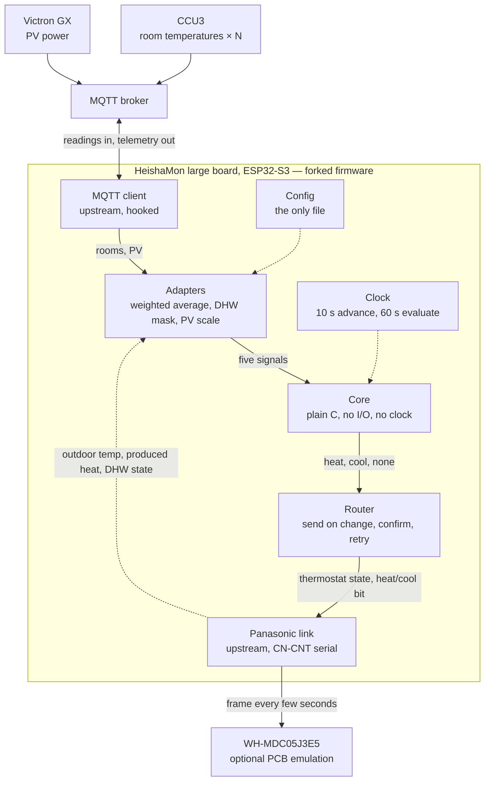

# Firmware Design — the control core inside a HeishaMon fork

**Status: design. Only the golden-trace exporter (§7, §10 step 1) is built.** It records where the
decision core will run, what surrounds it, and which questions are still open. Statements about
HeishaMon's source and about hardware that has not been bought are marked in §9; treat them as
claims to check, not facts.

`algorithm-plan.md` says what the core decides and why. `reference.md` is the core's API. This
document covers only the part neither of them does: the host. Rationale that lives in those
documents is cross-referenced, never restated.

---

## 0. Summary

The core is ported to plain C and compiled into a **fork of HeishaMon**, running on HeishaMon's
large ESP32-S3 board in place of the ESP8266 board that sits on the heat pump's CN-CNT cable today.
One device then holds the wire to the pump, the control law, and the network link.

- Outdoor temperature, produced heat and the demand command never leave the board.
- Room temperatures and PV power arrive over MQTT, the first required, the second optional.
- The pump is driven through the thermostat-demand input of HeishaMon's optional PCB emulation.
- The board stores configuration and nothing else. Every restart is a cold start.
- The fan coil is out of scope. It runs in its own automatic mode on water temperature.

---

## 1. Decisions

Marked **[F-n]** so later documents can cite them. *Owner* means the decision was the owner's and is
recorded here, not derived.

**[F-1] Host: a HeishaMon fork on the large ESP32-S3 board.** The CN-CNT cable is already routed to
the existing board, the larger board takes the same cable, and it has an Ethernet option. Hosting
the loop anywhere else leaves the pump link behind one wireless hop (§8). *Owner.*

**[F-2] The core is plain C with no framework includes.** It is about 1 000 lines of float
arithmetic over one struct. The same file must compile on the build PC for trace tests and inside
HeishaMon's Arduino build. The glue follows HeishaMon and is whatever its build is. This is the
Python core's own rule (`core/` imports no I/O, clock or logger) carried across; in C it is
enforced by the core directory including nothing but `math.h` and its own headers.

**[F-3] The seam to upstream is function calls that speak MQTT's vocabulary.** The fork reads pump
values by topic name as strings and issues commands by command name with a string value: the same
pairs an external MQTT client would see. There is no broker on the board and no loopback
connection. The rules engine is the precedent. Consequences: the loop runs with the broker down,
and the adapters would work unchanged behind a real subscription if the core ever moved out.

**[F-4] The pump is commanded as a thermostat, not through SmartGrid.** §4.

**[F-5] Only configuration is written to flash.** No status, no input value, not the energy
deviation. This supersedes **[A-10]** for this host; **[A-9]** applies on every boot. §5. *Owner.*

**[F-6] The indoor signal is a weighted average over a configurable list of room topics.** §3.1.
*Owner.*

**[F-7] Every input, status, output and configuration value is published.** Nothing the loop needs
is ever read back from the broker; the file on the board is the source of truth. §6.

**[F-8] The fan coil is not controlled.** A cooling decision switches the pump; the fan coil follows
the water temperature on its own. *Owner.*

**[F-9] The fork's own code lives in one directory**, with a handful of hook lines in upstream
files (§2.2), so that rebasing onto upstream stays small.

---

## 2. Architecture

A design sketch, not a generated diagram — nothing exists yet to generate it from.

Data flows downward; the dotted arrow back up is the pump's own readings returning as inputs.
Telemetry (§6) leaves through the same MQTT client. Dependencies point at the core, which knows
nothing outside itself.

### 2.1 Components, against the ports of `algorithm-plan.md` §2.5

| Component | Origin | Port it fills | Owns |
|---|---|---|---|
| MQTT client | upstream | — | broker connection, topics, bytes |
| Panasonic link | upstream | — | CN-CNT serial, frame decode, command encode |
| Adapters | fork | `SensorSource` | payload → the five signals; plausibility bounds; room average |
| Core | fork | — | the control law, unchanged from the Python reference |
| Router | fork | `DemandSink` | decision → pump commands; confirm and retry |
| Clock | fork | `Clock` (monotonic only) | the 10 s and 60 s ticks |
| Telemetry | fork | `DiagnosticsSink` | publishing §6 |
| Config | fork | — | parameters, room list; the one file |
| — | — | `StateStore` | **not implemented**, per **[F-5]** |

Adapters, core and router are pure with respect to the framework: they take values and return
values. That is what lets them be tested on the build PC (§7).

### 2.2 Hook points in upstream

1. **Main loop** — one call into the clock on every pass. It must return immediately when no tick
   is due, and never block.
2. **MQTT callback** — configured room and PV topics are handed to the adapters.
3. **Decoded pump values** — outdoor temperature, produced heat and the DHW state, taken from the
   decoder or from the point where upstream publishes them. The hook must not sit behind an
   "only if the broker is connected" test.
4. **Command sender** — the function upstream's command topics and rules engine already use.

Plus one call from setup to load the config.

---

## 3. Inputs

| Signal | Source | Path | Required | On loss |
|---|---|---|---|---|
| `T_INDOOR` | CCU3 room thermostats | MQTT | yes | `HOLD`, then `FAULT` |
| `T_OUTDOOR` | pump | in-process | yes | `HOLD`, then `FAULT` |
| `P_PRODUCED` | pump, masked while on DHW **[A-3]** | in-process | yes | `HOLD`, then `FAULT` |
| `P_SOLAR` | GX PV power × `solar_gain_factor` | MQTT | no | fallback `0 W` |
| `P_INTERNAL` | configured constant, `550 W` | — | no | — |

Ages, fallbacks and the hold-then-fail policy are the core's own (`algorithm-plan.md` §4,
**[A-11]**, **[A-20]**). The adapters drop implausible readings before the core sees them, as §2.5
there requires.

Two of the three required signals now arrive without touching the network. `T_INDOOR` is the one
required signal that still does.

A measured `P_INTERNAL` from the GX power balance (grid + PV − battery − wall box − heat pump)
is a possible later upgrade over the constant. It is not part of this design.

### 3.1 The room average

The room thermostats are thermometers only. The floor heating is balanced once and left open, so no
second control loop acts on the rooms, and the average means what the core assumes it means.

- **Configuration:** a list of entries, each a topic and a weight. From one entry up to a fixed
  compile-time maximum (proposed: 16), so the adapter needs no dynamic memory. Weight defaults to 1.
- **Value:** the weighted mean over the rooms that are fresh,
  `Σ wᵢ·Tᵢ / Σ wᵢ`.
- **Cadence:** emitted to the core on the board's own 60 s clock from each room's last value — not
  when a thermostat happens to report. This reproduces the consolidated 60 s average the legacy
  loop ran on and the simulator's transport model assumes.
- **Per-room freshness:** a room older than its timeout leaves the average. Proposed timeout:
  30 minutes. Room temperatures move slowly, and a generous timeout keeps membership stable
  through ordinary reporting gaps.
- **Group freshness:** the average is emitted only while the fresh rooms carry more than half of
  the total weight. Otherwise nothing is emitted and the core's own staleness handling takes over.
- **Weight zero:** the room is published in telemetry but does not count. A way to watch a new
  sensor before trusting it.
- **Parser:** a bare number, or a JSON object with a value field.

Three consequences to accept knowingly:

1. **The per-room timeout is the real staleness limit for the indoor signal.** The adapter keeps
   emitting from held room values, so the core's 600 s limit on `T_INDOOR` only trips once the
   group rule fails. With a 30-minute room timeout the loop can run that long on room values that
   have not been refreshed.
2. **Changing the list or the weights moves what the setpoint means.** The setpoint and
   `adjustment_w_per_k` were fitted against the plain mean of the five archived sensors, three of
   them on the warm ground floor (`house-model-plan.md` §4.6.1). All weights at 1 on those five
   reproduces the legacy. Anything else is a retune.
3. **A room leaving the average makes it jump**, by up to several tenths of a kelvin across the
   measured 3–4 K gradient, and the trim turns that into a few hundred watts. Bounded by
   **[A-14]**.

The single-zone house model cannot say what the right weights are. That needs the zoned model the
house plan lists as not yet built.

---

## 4. Output

The pump is a Panasonic WH-MDC05J3E5, a J-series unit. HeishaMon's optional PCB emulation, which
the installation already uses for SmartGrid, exposes a thermostat-demand input:

| Decision | `SetExternalThermostat1State` | `SetHeatCoolMode` |
|---|---|---|
| `HEATING` | `2` (heat demand) | heat |
| `COOLING` | `1` (cool demand) | cool |
| `NO_DEMAND` | `0` (no demand) | unchanged |

Hot water is not this loop's business (concept brief §3). It continues under whatever operation
mode is set on the pump. SmartGrid, which carries the heating demand today, is released and stays
at normal.

Router rules, from HeishaMon's documentation of its own command path:

- **Send on change only.** The emulated frame repeats the current state by itself; the router only
  changes it. Frequent writes of pump settings wear the pump's EEPROM, and upstream asks for a few
  changes per hour per setting at most. `H = 1500 Wh` already paces the loop far below that.
- **Confirm and retry.** Commands are asynchronous and can be dropped. After a change the router
  checks the pump's own reported state and resends if it did not land.
- **A boot starts at no demand** until the core has seen fresh inputs (`Phase.UNINITIALIZED`).

**The 40-second rule.** The emulated frame must be sent continuously. If it stops for about 40 s
the pump raises H74 and goes to standby. This is already true of today's installation. It is also
the strongest argument for **[F-1]**: with the core on the board, the demand is a field in a frame
the board is sending anyway, with no broker, network or second device between decision and pump.

Cooling through the energy balance is new behaviour with no field precedent
(`algorithm-plan.md` §5, open item 1). The core's direction mask (`set_allowed`) exists for exactly
this; see §9.

---

## 5. Time, state and persistence

**Time.** The core needs elapsed seconds that never jump. The fork derives them from the
millisecond counter widened to 64 bits, since the 32-bit counter wraps every 49.7 days. Wall-clock
time is used nowhere: the snapshot's freshness check was its only consumer (**[A-12]**).

**Ticks.** `advance` every 10 s, `evaluate` every 60 s (**[A-24]**), driven from the main loop.

**Persistence.** Only the configuration, written only when a value changes. At boot it is read from
the file, never from a retained broker message.

**What a restart costs.** Energy deviation zero, no demand, wait for fresh readings. The discarded
charge is bounded by the anti-windup clamp at `2H = 3000 Wh` (**[A-7]**) and normally lies within
one band of `1500 Wh`. The trim repays it. This is the same event as the core's own reset after a
blind period (**[A-11]**), which the simulator and tests already cover; the chronogram in
`docs/diagrams/` shows one.

**What it leaves open.** Each restart zeroes the deficit, so a board that restarts more often than
a band takes to fill never engages heating. In mild weather a band takes hours. The trim limits
the damage, but the failure looks like a mild day. Uptime and a restart counter are therefore part
of the telemetry.

**Port consequence.** The C core has no `restore` and no snapshot type. Golden traces start cold.

---

## 6. MQTT surface and configuration

Everything is published under a subtree of the fork's own, beside HeishaMon's topics and never
inside its numbered `main/` table. Names below are proposals.

| Group | Content | When |
|---|---|---|
| inputs | the five signals as the core saw them; stale / substituted flags; per room: value, weight, fresh; count and weight of fresh rooms | each 60 s tick |
| status | energy deviation, net balance, phase, reason, demand; uptime, restart counter | each 60 s tick |
| outputs | last command sent, whether the pump confirmed it | on change |
| config | every parameter, retained | on change and at boot |

**Changing configuration.** A command topic per parameter, in the style of upstream's pump
commands. The firmware builds a new config and runs the core's own `validate()`. Valid: save,
apply from the next tick, echo. Invalid: reject, echo the old value. Anyone who can publish to the
broker can change the setpoint, which is the trust level the pump's command topics already have.

**Web interface.** Later, and read-only first. A tab means editing upstream's page code, which is
the expensive part of a fork to carry.

---

## 7. Verification

| Layer | Where it is tested | Against |
|---|---|---|
| Core | build PC | **golden traces**: every `observe` / `advance` / `evaluate` call and each resulting decision, exported from the Python core running the simulator's scenarios, fault injections included. The C core must reproduce demand, reason, phase and energy on every line. |
| Adapters, router | build PC | ordinary unit tests; they are pure |
| Fork glue | the board on a bench | a broker fed by the Python simulator acting as the house |
| Pump protocol | upstream's | not retested |

The golden-trace exporter is a tap on the path the simulator already has from its transport layer
into the core: `heatnrgx/sim/golden.py`, with the format in `golden-traces.md` and the committed set
in `golden/`.

Not covered by any of this: the pump's real response to the thermostat commands (§9), the CCU3's
real reporting cadence, and the network at the installation site.

---

## 8. Alternatives considered

| Alternative | Why not |
|---|---|
| Standalone ESP32 (LilyGO T-RSC3, or a Waveshare DIN-rail ESP32-S3 with RS485 / Ethernet) talking to HeishaMon over MQTT | Leaves outdoor temperature, produced heat and the command path behind HeishaMon's Wi-Fi and the broker. A silent HeishaMon stops the pump (H74) whatever another box does. Its RS485 port only mattered for the fan coil, which **[F-8]** removes. |
| The same, with the Panasonic protocol lifted into the standalone firmware | Removes the hop, but re-hosts and maintains a protocol decoder that upstream already maintains. |
| HeishaMon's rules engine | No host runtime, so no trace testing; no per-signal timestamps, so the staleness logic would be rebuilt from timers; no documented way to read room temperatures from MQTT. A rule remains a candidate for a fallback only. |
| The fork on the existing ESP8266 board | Works for heating and costs nothing, but Wi-Fi only and close to its memory limit. Still a valid first step if the large board is delayed. |
| The Python core on the GX or another Linux box | No port needed, but trades firmware for an operating system to look after, and keeps the wireless hop to the pump. |
| Persisting the energy deviation (**[A-10]**) | Rejected by **[F-5]**: bounded benefit, against flash writes, a wall clock and a restore path. |

---

## 9. Not verified, and open

**Claims in this document that were not checked against a primary source:**

1. **HeishaMon's source was not read.** The four hook points in §2.2, the existence of a single
   command function shared with the rules engine, and a decoder callable by topic name are
   recollection. Read the source before estimating the fork.
2. **The large board.** That the board the owner calls v6 is HeishaMon's ESP32-S3 board, that it
   takes the existing cable unchanged, and that Ethernet is a plug-on W5500 module needing an
   external 5 V supply come from the project README and a reseller's summary, not from the board
   documentation.
3. **`SetHeatCoolMode` polarity.** Upstream documents the command as `0/1` on the heat/cool bit
   without saying which is which.
4. **How the CCU3 publishes.** Topic names, payload shape, retained behaviour and which broker
   carry the room temperatures are not known here. If retained values are replayed on reconnect, a
   dead thermostat can look fresh once; a payload timestamp, where present, lets the adapter refuse
   values that do not advance.
5. **Upstream calls the optional PCB emulation experimental**, and notes that with it enabled the
   board does not open its Wi-Fi hotspot after a failed connection.

**To settle on the pump, by hand, before any code depends on it:**

6. Does the heat/cool bit alone switch the pump between heating and cooling, or only with the
   installer setting for external heat/cool control enabled?
7. Is the thermostat demand honoured in the operation mode used today, and does hot water carry on
   beside it?

**Open design questions:**

8. **Ship with cooling masked off?** Recommended for the first winter: restrict the core to
   heating with `set_allowed`, as a config switch, and enable cooling as its own commissioning step.
9. **Fallback when the loop cannot decide.** `FAULT` means no demand, which in winter means no
   heat until an input returns. Handing the pump back to its own weather curve after a longer
   outage would be more forgiving. Not designed.
10. **PV over MQTT.** If the broker is the GX's own, its topics stop after about a minute without a
    keepalive. The fork should send that keepalive itself, so the optional signal does not depend
    on some other client being connected.
11. **The bench has no pump.** Either a serial emulator answers on CN-CNT, or a test build injects
    decoded values at hook 3. Not decided.
12. **Licence.** HeishaMon is MPL-2.0; changes to its files stay under it. This repository has no
    licence file yet.

---

## 10. Order of work

1. ~~Golden-trace exporter in `heatnrgx.sim`, and the trace format.~~ Done: `golden-traces.md`.
2. The C core, passing the traces on the build PC.
3. Adapters and router with host tests; the room average first.
4. Items 6 and 7 of §9, by hand over MQTT on the existing board.
5. Read HeishaMon's source; place the hooks; build the fork for the large board.
6. Bench run against the simulator, then heating on the house with cooling masked off.

---

## Sources

- HeishaMon README — board variants, CN-CNT serial parameters, command behaviour, licence:
  <https://github.com/Egyras/HeishaMon>
- HeishaMon `OptionalPCB.md` — thermostat, heat/cool and SmartGrid commands; the 40 s rule:
  <https://github.com/Egyras/HeishaMon/blob/master/OptionalPCB.md>
- HeishaMon `MQTT-Topics.md` — topic and command tables:
  <https://github.com/Egyras/HeishaMon/blob/master/MQTT-Topics.md>
